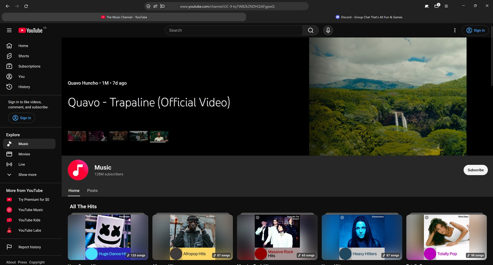
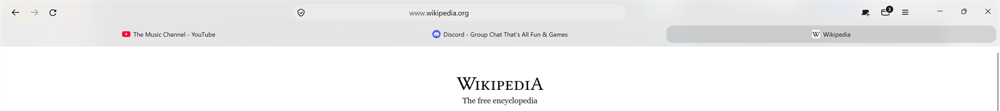
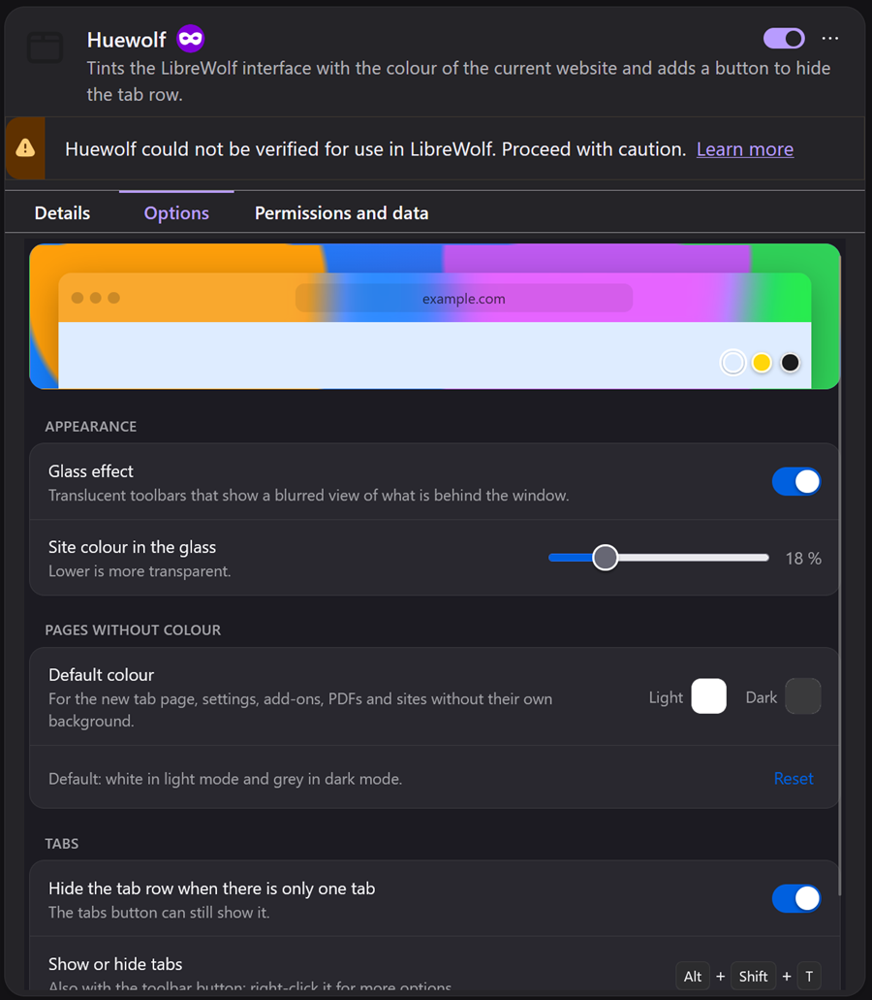

# Huewolf

**[Read in English](README.md)**

Tema minimalista para [LibreWolf](https://librewolf.net) en el que las barras toman el color de la web que estás viendo.

<p align="center">
  
</p>
<p align="center">
  
  
</p>
<p align="center">
  
</p>

- **Color dinámico:** la barra de dirección, las pestañas y los menús se tiñen con el color de la página. Cada ventana tiene el suyo.
- **Cristal opcional:** barras translúcidas que dejan ver, desenfocado, lo que hay detrás de la ventana (Windows 11).
- **Diseño compacto:** dirección arriba y centrada, marcadores debajo y pestañas al final. Las pestañas tienen todas el mismo ancho y el título centrado.
- **Botón de pestañas:** oculta la fila de pestañas desde la barra o con <kbd>Alt</kbd>+<kbd>Mayús</kbd>+<kbd>T</kbd>. Se oculta sola cuando solo hay una pestaña, y el botón muestra cuántas hay abiertas.

Tiene dos partes que funcionan juntas:

| Carpeta | Qué es |
|---|---|
| `chrome/` | Estilos `userChrome.css` para la interfaz del navegador |
| `extension/` | La extensión que lee el color de cada página y se lo pasa a la interfaz (empaquetada en `huewolf.xpi`) |

> Probado en **LibreWolf 159 / Windows 11**. Debería funcionar también en Firefox 128 o posterior, pero la extensión no está firmada (ver paso 4). La extensión está en inglés y en español y sigue el idioma del navegador.

## Instalación

1. **Abre la carpeta de tu perfil.** Ve a `about:support`, busca *Carpeta de perfil* y pulsa **Abrir carpeta**.
2. **Copia los estilos.** Copia la carpeta `chrome/` de este repositorio dentro de la carpeta del perfil. Si ya tienes una carpeta `chrome/`, haz antes una copia de seguridad.
3. **Activa los estilos personalizados.** Copia `user.js` en la carpeta del perfil, junto a `chrome/`. O cambia esto a mano en `about:config`:
   - `toolkit.legacyUserProfileCustomizations.stylesheets` = `true`
   - Solo para la versión cristal: `widget.windows.mica` = `true` y `widget.windows.mica.toplevel-backdrop` = `2`
4. **Instala la extensión.**
   - En `about:config`, pon `xpinstall.signatures.required` = `false`. LibreWolf, Firefox ESR, Developer Edition y Nightly lo permiten; el Firefox normal no.
   - En `about:addons`, pulsa el engranaje ⚙️, elige **Instalar complemento desde archivo…** y selecciona `huewolf.xpi`.
   - Opcional: en la página de la extensión, permite **Ejecutar en ventanas privadas**.
5. **Reinicia LibreWolf.**

Para el cristal, en Windows tiene que estar activado **Configuración → Personalización → Colores → Efectos de transparencia**.

## Opaco o cristal

En `chrome/userChrome.css` deja activa solo una de las dos líneas:

```css
@import url("huewolf-glass.css");   /* cristal */
/* @import url("huewolf.css"); */   /* opaco */
```

También puedes activar o quitar el cristal sin reiniciar: clic derecho en el botón de pestañas → **Efecto cristal**.

## Ajustes

Clic derecho en el botón de pestañas → **Ajustes de Huewolf…**, o `about:addons` → Huewolf → Opciones. Puedes cambiar:

- **Efecto cristal:** lo activa o lo quita. Otro control ajusta cuánto color de la web se ve en el cristal.
- **Color predeterminado:** el que se usa en la nueva pestaña, los ajustes, los complementos, los PDF y las webs sin fondo. Uno para modo claro y otro para oscuro.
- **Ocultar la fila de pestañas si solo hay una.**



Para cambiar lo redondeado de las esquinas, edita `--hw-radius` al principio de `chrome/huewolf.css`.

## De dónde sale el color

Para cada página, la extensión usa por orden:

1. `<meta name="theme-color">`, respetando el modo claro y el oscuro.
2. El color de la franja superior de la página (la cabecera), si es uniforme.
3. El fondo de la página.
4. Si no hay nada de lo anterior, el color predeterminado de los Ajustes.

Todo se lee en tu equipo; la extensión no envía nada a ningún sitio.

## Traducciones

Los textos están en `extension/_locales/<idioma>/messages.json`. Para añadir un idioma, copia la carpeta `en`, tradúcela y añade tu texto de `actionShow` a los selectores de `chrome/huewolf.css` (sirven para detectar cuándo está oculta la fila de pestañas).

## Empaquetar la extensión

Si cambias algo en `extension/`, vuelve a generar `huewolf.xpi`:

```powershell
powershell -ExecutionPolicy Bypass -File build.ps1
```

Después reinstálala desde `about:addons`; los ajustes se conservan.

## Desinstalar

Quita la extensión en `about:addons`, borra `chrome/` y `user.js` de la carpeta del perfil y reinicia.

## Licencia

[MIT](LICENSE)
