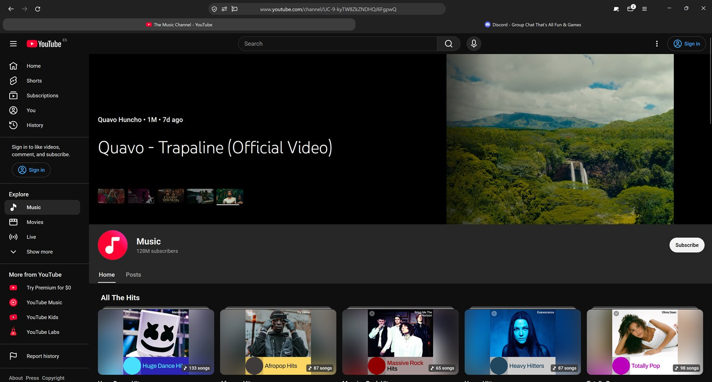
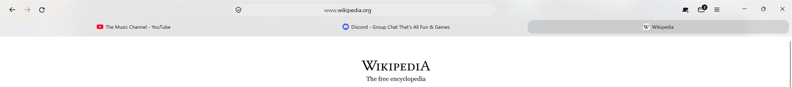
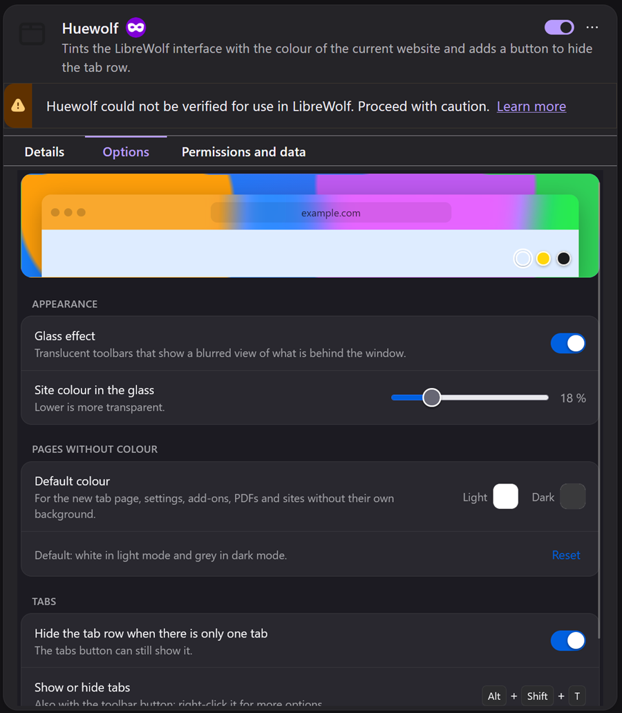

# Huewolf

**[Leer en español](README.es.md)**

A minimal theme for [LibreWolf](https://librewolf.net) whose toolbars take on the colour of the website you are viewing.

<p align="center">
  
</p>
<p align="center">
  
  
</p>
<p align="center">
  
</p>

- **Dynamic colour:** the address bar, tabs and menus are tinted with the page's colour. Each window has its own tint.
- **Optional glass:** the toolbars are translucent and show a blurred view of what is behind the window (Windows 11).
- **Compact layout:** the address bar is on top and centred, bookmarks sit below it and tabs come last. Tabs share the width equally with centred titles.
- **Tab row toggle:** a toolbar button (or <kbd>Alt</kbd>+<kbd>Shift</kbd>+<kbd>T</kbd>) hides the tab row. It hides on its own when only one tab is open, and the button shows how many tabs are open.

It has two parts that work together:

| Folder | What it is |
|---|---|
| `chrome/` | `userChrome.css` styles for the browser interface |
| `extension/` | The extension that reads each page's colour and sends it to the interface (packaged as `huewolf.xpi`) |

> Tested on **LibreWolf 159 / Windows 11**. It should also work on Firefox 128+, but the extension is not signed (see step 4). The extension is available in English and Spanish and follows the browser's language.

## Installation

1. **Open your profile folder.** Go to `about:support`, find *Profile Folder* and click **Open Folder**.
2. **Copy the styles.** Copy this repo's `chrome/` folder into the profile folder. If you already have a `chrome/` folder there, back it up first.
3. **Turn on custom styles.** Copy `user.js` into the profile folder, next to `chrome/`. Or set these by hand in `about:config`:
   - `toolkit.legacyUserProfileCustomizations.stylesheets` = `true`
   - For the glass version only: `widget.windows.mica` = `true` and `widget.windows.mica.toplevel-backdrop` = `2`
4. **Install the extension.**
   - In `about:config`, set `xpinstall.signatures.required` = `false`. LibreWolf, Firefox ESR, Developer Edition and Nightly allow this. Regular Firefox does not.
   - In `about:addons`, click the ⚙️ gear, choose **Install Add-on From File…** and pick `huewolf.xpi`.
   - Optional: in the extension's page, allow **Run in Private Windows**.
5. **Restart LibreWolf.**

Glass also needs **Settings → Personalization → Colors → Transparency effects** turned on in Windows.

## Opaque or glass

Edit `chrome/userChrome.css` so that exactly one line is active:

```css
@import url("huewolf-glass.css");   /* glass */
/* @import url("huewolf.css"); */   /* opaque */
```

You can also turn glass on or off without restarting. Right-click the tabs button and choose **Glass effect**.

## Settings

Right-click the tabs button and choose **Huewolf settings…**, or go to `about:addons` → Huewolf → Options. You can change:

- **Glass effect:** turns glass on or off. A second control sets how much of the page colour shows through.
- **Default colour:** the colour used for the new tab page, settings, add-ons, PDFs and sites without a background. You can set one for light mode and one for dark mode.
- **Hide the tab row when there is only one tab.**



To change corner roundness, edit `--hw-radius` at the top of `chrome/huewolf.css`.

## How the colour is chosen

For each page the extension uses, in order:

1. `<meta name="theme-color">`, respecting light and dark mode.
2. The colour of the top strip of the page (its header), if it is uniform.
3. The page background.
4. Otherwise, the default colour from Settings.

Everything is read locally. The extension sends nothing anywhere.

## Translations

Texts live in `extension/_locales/<language>/messages.json`. To add a language, copy the `en` folder, translate it, and add your `actionShow` text to the selectors in `chrome/huewolf.css` (they detect when the tab row is hidden).

## Building the extension

After changing anything in `extension/`, rebuild `huewolf.xpi`:

```powershell
powershell -ExecutionPolicy Bypass -File build.ps1
```

Then reinstall it from `about:addons`. Your settings are kept.

## Uninstall

Remove the extension in `about:addons`, delete `chrome/` and `user.js` from your profile folder, and restart.

## License

[MIT](LICENSE)
